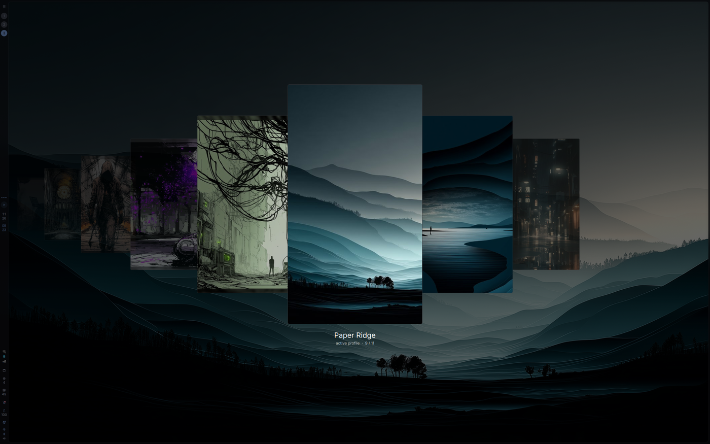

# Profiles

[English](README.md) · **Deutsch** · [Español](README.es.md) · [Français](README.fr.md) · [Italiano](README.it.md) · [Português](README.pt.md) · [Русский](README.ru.md) · [日本語](README.ja.md) · [简体中文](README.zh_CN.md)

Ein Plugin für [DankMaterialShell](https://github.com/AvengeMedia/DankMaterialShell), das die Optik der Shell unter einem Namen speichert und zwischen diesen Optiken wechseln lässt. Ein Profil enthält Theme und Akzentfarbe, hellen oder dunklen Modus, das Hintergrundbild, die Leisten, den Rahmen, Transparenz, Schriften, Animationen und Desktop-Widgets samt ihrer Position.



Schritt für Schritt mit Bildern: [Anleitung zu Installation und Einrichtung](docs/GUIDE.de.md).

## Wechseln

Die Profilauswahl öffnet sich per Tastenkombination, dort wählt man ein Profil. Während des Wechsels ist der Bildschirm etwa eine Sekunde lang eingefroren, darunter wird das Profil angewendet, und dann verschwindet das alte Bild mit einer Animation. Leisten, Farben und Hintergrundbild wechseln in einem Zug statt nacheinander.

Zur Wahl stehen 29 Übergänge, darunter Überblenden, Wischen, Kreis, Türen, Jalousie, Schmelzen, Splitter, eine abschaltende Bildröhre, ein Schneesturm und fünf Hack-Effekte. Zufällig lässt sich auf die Übergänge beschränken, die einem gefallen. Bei den meisten Animationen leuchtet die Kante in der Akzentfarbe des neuen Profils.

## Profilauswahl

Die Auswahl gibt es in vier Ansichten: eine Leiste mit Rahmen, dieselbe Leiste frei ohne Rahmen, ein Karussell mit dem aktuellen Profil groß in der Mitte und Kacheln über den ganzen Bildschirm. Die Vorschaubilder können hochkant, quer, quadratisch, rund, sechseckig oder rautenförmig sein. In der Kachelansicht liegen Sechsecke und Rauten als Waben, mit demselben Abstand wie die Fenster. Rahmen, Leuchten, Haken und Eckenradius lassen sich abschalten oder anpassen.

Mausrad und Pfeiltasten bewegen die Auswahl, Enter oder ein Klick wendet das Profil an, Escape schließt die Auswahl.

## Speichern

Änderungen in den DMS-Einstellungen landen nach ein paar Sekunden im aktiven Profil. Jedes Profil merkt sich, wie es beim Aktivieren aussah, daher lassen sich die Änderungen auf der Einstellungsseite zurücknehmen. Das Hintergrundbild wird ins Profil kopiert. Wird die Originaldatei verschoben oder gelöscht, bleibt das Profil also intakt.

Profile liegen in `~/.config/DankMaterialShell/profiles/`, ein Ordner pro Profil.

## Einstellungen anderer Plugins

Auch Plugin-Einstellungen können zu einem Profil gehören. Dazu die Plugin-IDs unter Einstellungen → Plugins → Profiles → Im Profil mitgespeicherte Plugins eintragen, zum Beispiel `audioFx`.

## Dinge außerhalb von DMS

Terminalfarben, Browser-Themes oder Compositor-Regeln, um die sich DMS nicht kümmert, lassen sich mit zwei optionalen Befehlen abdecken:

- Der Befehl beim Speichern läuft, wenn ein Profil gespeichert wird. Das JSON, das er ausgibt, landet im Profil unter `extras`.
- Der Befehl beim Anwenden läuft während des Wechsels, sobald DMS die neuen Einstellungen geladen hat. Der Bildschirm wird erst aufgedeckt, wenn er fertig ist. Er bekommt `DMS_PROFILE_DIR`, `DMS_PROFILE_SLUG`, `DMS_PROFILE_NAME` und `DMS_PROFILE_NEW_COLORS` (1, wenn neue Farben erzeugt werden). Die Profildatei ist `$DMS_PROFILE_DIR/profile.json`.

Ein kleines Beispiel, das die GTK-Oberflächenschrift je Profil festhält:

```sh
# save command
printf '{"font": "%s"}' "$(gsettings get org.gnome.desktop.interface font-name | tr -d "'")"

# apply command
gsettings set org.gnome.desktop.interface font-name \
  "$(python3 -c 'import json,os; print(json.load(open(os.environ["DMS_PROFILE_DIR"] + "/profile.json"))["extras"]["font"])')"
```

## Voraussetzungen

DankMaterialShell 1.6.1 oder neuer. Der Übergang nutzt `dms screenshot`, das bei DMS dabei ist. Ich nutze das Plugin unter niri. Fensterabstände, Eckenradius und Rahmenbreite schreibt DMS selbst in die Compositor-Konfiguration, daher sollten sie auch auf anderen von DMS unterstützten Compositors dem Profil folgen.

## Installation

```sh
git clone https://github.com/21Rebel/dms-profiles ~/.config/DankMaterialShell/plugins/DmsProfiles
dms ipc call plugins enable dmsProfiles
```

Danach eine Tastenkombination anlegen, zum Beispiel in niri:

```kdl
Mod+Shift+M { spawn "dms" "ipc" "call" "profiles" "toggle"; }
```

## IPC

```sh
dms ipc call profiles toggle
dms ipc call profiles list
dms ipc call profiles apply <slug>
dms ipc call profiles create <name>
dms ipc call profiles save
dms ipc call profiles rename <slug> <new name>
dms ipc call profiles remove <slug>
dms ipc call profiles move <slug> left|right|<position>
dms ipc call profiles reset <slug>
dms ipc call profiles previewTransition <type>
dms ipc call profiles status
```

## Übersetzungen

Das Plugin gibt es auf Deutsch, Spanisch, Französisch, Italienisch, Portugiesisch, Russisch, Japanisch und vereinfachtem Chinesisch. Es folgt der Sprache, die in DMS eingestellt ist. Liest sich eine Übersetzung falsch, ist ein Pull Request willkommen.

## Hinweis

Ich habe dieses Plugin mit Hilfe von Claude (Anthropic) geschrieben und nutze es jeden Tag auf meinem eigenen Desktop.

## Lizenz

MIT
