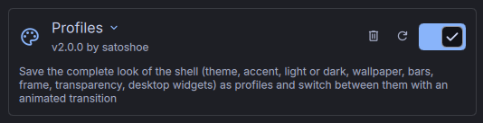
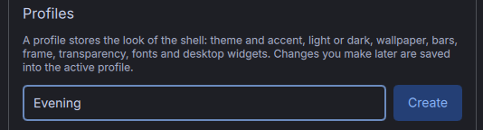
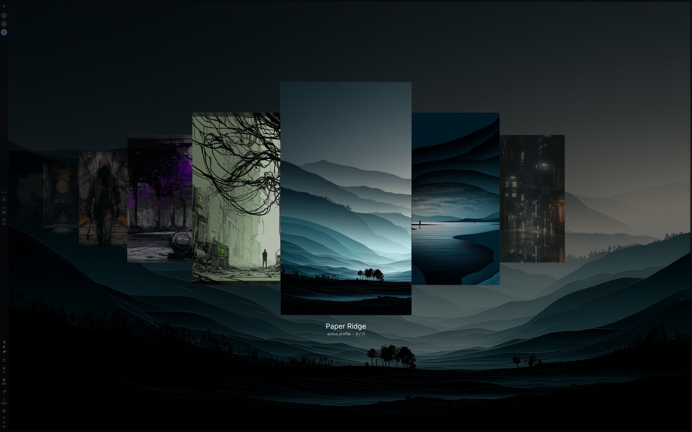
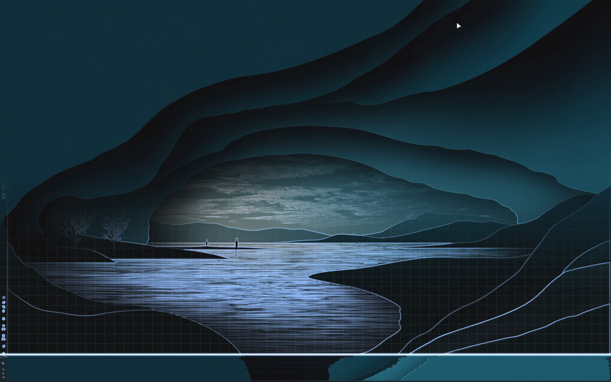
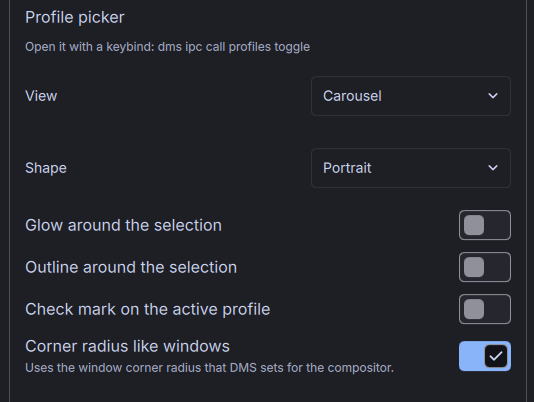
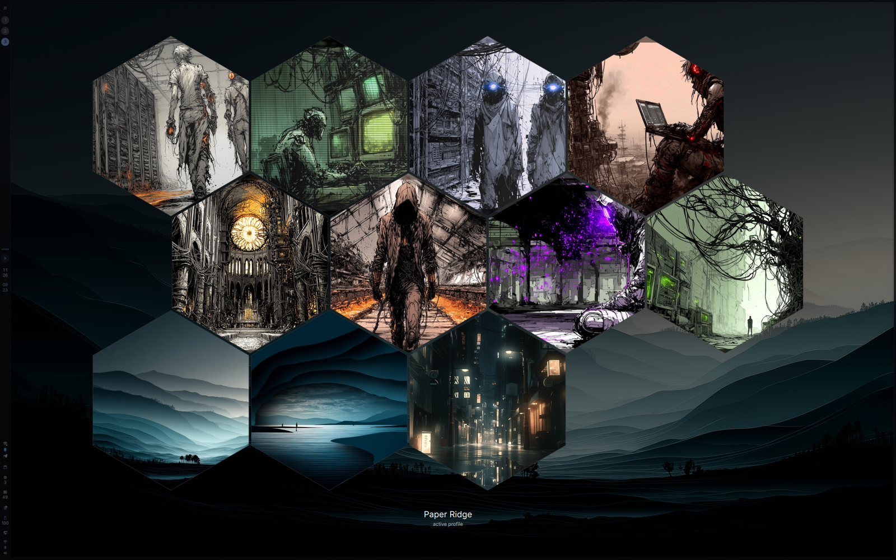
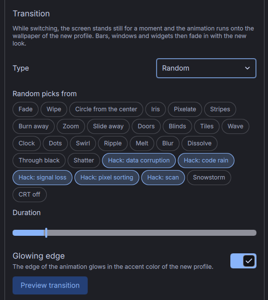
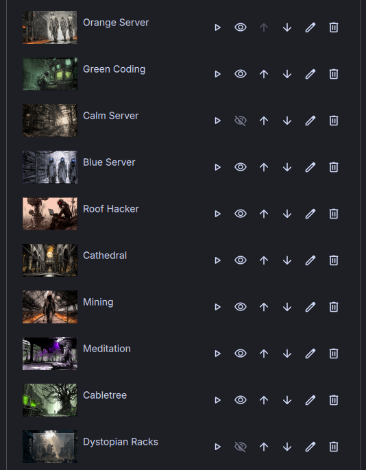

# Profiles: passo a passo

[English](GUIDE.md) · [Deutsch](GUIDE.de.md) · [Español](GUIDE.es.md) · [Français](GUIDE.fr.md) · [Italiano](GUIDE.it.md) · **Português** · [Русский](GUIDE.ru.md) · [日本語](GUIDE.ja.md) · [简体中文](GUIDE.zh_CN.md)

## 1. Instale e ative o plugin

```sh
git clone https://github.com/21Rebel/dms-profiles ~/.config/DankMaterialShell/plugins/DmsProfiles
```

Abra Configurações → Plugins e ative o Profiles.



## 2. Crie seu primeiro perfil

Deixe o shell do jeito que você gosta: tema, cor de destaque, papel de parede, barra, frame. Depois expanda o Profiles na lista de plugins, digite um nome e clique em “Criar”.



O novo perfil fica ativo na hora. Tudo o que você mudar depois é salvo nele após alguns segundos.

## 3. Crie um segundo

Mude a aparência, por exemplo com outro papel de parede e outra cor de destaque, e crie um segundo perfil do mesmo jeito. Agora as mudanças vão para o segundo perfil, e o primeiro continua como estava.

## 4. Adicione um atalho para o seletor

No niri, adicione à sua configuração:

```kdl
binds {
    Mod+Shift+M { spawn "dms" "ipc" "call" "profiles" "toggle"; }
}
```

## 5. Troque de perfil

Pressione o atalho, escolha um perfil com a roda do mouse ou as setas do teclado e pressione Enter ou clique nele.



A tela congela por cerca de um segundo, o perfil é aplicado por baixo e depois revelado com uma animação.



## 6. Escolha a aparência do seletor

Em “Seletor de perfis”, escolha a visualização (fileira, livre, carrossel ou grade) e o formato das prévias.





## 7. Escolha a transição

Em “Transição”, escolha um tipo ou deixe em “Aleatória”. Com Aleatória, clique nos tipos que você quer permitir. “Testar transição” reproduz a animação uma vez sem trocar de perfil, com a imagem antiga em cinza.



## 8. Gerencie os perfis

A lista no topo das configurações do plugin tem botões para aplicar, renomear, mover para cima ou para baixo e excluir um perfil. O botão de desfazer ao lado do perfil ativo traz de volta o estado que ele tinha quando foi ativado.



## 9. Configurações de plugins em um perfil (opcional)

Para manter as configurações de outro plugin por perfil, digite o id dele em “Plugins salvos com o perfil”, por exemplo `audioFx`.

## 10. Coisas fora do DMS (opcional)

Em “Avançado” você pode definir um comando ao salvar e um comando ao aplicar para configurações que o DMS não gerencia, como as cores do terminal. Veja no README o que eles recebem e um exemplo.
